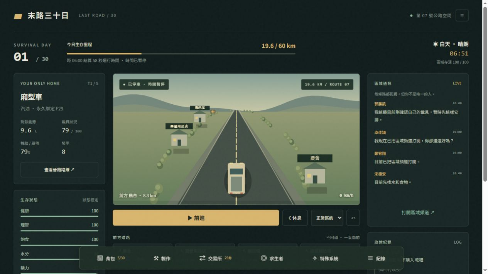

# 末路三十日可玩原型

這是單人、瀏覽器本機存檔的公路求生遊戲。按「前進」觀看道路與載具移動；道路兩側出現建築與事件，到達時自動停車，以選項決策。完成第 30 天的每日里程結算且仍存活，即為勝利。

**[直接開始試玩](https://ourfo.github.io/last-road-thirty-days/)**

## 啟動

- 最簡單：開啟同目錄的 `末路三十日.html`，不需要安裝套件或連線。
- 開發預覽：在本目錄執行 `node serve.cjs`，瀏覽 `http://127.0.0.1:4173`。
- 模組化檔案在 `dist/`；沒有外部程式庫或遠端圖片依賴。

## 本版規則

運行 60 秒＝遊戲 24 小時；開始於 06:00，次日 06:00 結算。事件、管理介面、手動暫停及切到背景分頁時停止計時。行駛、搜索、製作與休息才推進時間。遊戲天數不是現實日期，也沒有離線死亡。

每日要求：第 1–3 天 60 公里、第 4–7 天 90、第 8–14 天 120、第 15–21 天 150、第 22–30 天 180。多走不抵隔日，未達標即死。確認逆行立即死亡。白天不隨機遇怪，夜間有襲擊；天氣與缺乏食水可持續損害健康。

52 車系皆可抽取，永久綁定，每系五階，共 260 個型態。初版不保證各車系／種子可通關；弱勢車系路上補給更密集，仍可能因時間、能源、天氣或選擇而失敗。人力載具可沿既定路線升為動力車，不能轉系。

道路節奏已調整：一般載具地點間隔 26–44km，微型／自行車為 14–24km，第 8 天起再拉長。既有存檔的前方地點會一次性拉開，保留原事件、背包與當前遭遇。積水、倒樹與路障不產物資，需用時間／精力或輪胎／車況通過；廣播提供天候情報。停靠時顯示剩餘里程、生存狀態與下一地點距離，供玩家決定是否搜索。

快速搜索 45 遊戲分鐘，通常 1–2 項；深搜 150 分鐘，通常 2–3 項，極高品質最多 4 項；兩者都可能搜空。食水較常出現可堆疊的乾糧與淨水，單項補給量提高；燃料按載具耗能換算，重耗能載具較常取得桶裝能源。常見材料以布料、塑膠、金屬等維修需求為主。夜間深搜受傷率 45%／健康損失 13，白天為 25%／8。日常食物每小時消耗 2，水分為 3、高溫為 5；每日里程與夜襲規則保留。

普通背包容量為人物 6 格加載具格數，一般消耗品每格最多5個，第6個另占一格；工具、武器、防具與配件維持一件一格。背包逐格顯示，使用後自動重新堆疊。金屬、零件等 18 類工程材料記數值帳本，不佔格。搜索完成後所有所得先列為現場清單，由玩家輸入拿取數量，或拿取目前可容納數量；材料也需選取。清單顯示數量、目前持有及剩餘背包格數，可先整理背包再返回。留下物資會再次列出清單確認，離開即放棄。掛單最多五張，退回物未處理前不可繼續上架，避免當成無限倉庫。

建築停靠期間提供 35 點環境遮蔽，行駛後失效。玩家有頭部、面部、眼部、身體、足部與武器六個裝備欄，同欄互斥；衣服、背心、披風與毯子共用身體欄。只有已裝備衣物及武器提供對應防護／戰力，未裝備的同類物品不疊加。裝備仍占背包格數；換裝或卸下不會複製物品，正在裝備的唯一一件不能上架、丟棄或回收。工具留在背包備用。舊存檔可繼續使用，但需手動裝備原有衣物與武器；舊版已取得的搜索所得不會重複發放。

製作與載具升級逐項顯示「持有／需要／缺少」資源，資源或其他條件不足時停用按鈕。製作需求使用同一套實際扣款規則，包含加工系統折扣；升級另顯示日期、車況與工作狀態。改裝可增加防護；休息恢復精力，食水充足時有少量健康恢復。夜襲可防衛、躲藏或沿正向逃離。

本次新增12種小／中／大型天災、13類三階通用配件及12類公共副本。前三天正常天候，第四天起隨機預警；天災不再作為公共事件。配件只有增益，全部52車系共用同一版本。詳見 [天候、配件與公共副本規格](天候配件與公共副本規格.md)。

背包使用道具時，右下角顯示實際狀態前後值，滑入後停留2秒再滑出。搜索物資支援部分拿取與實際可容納量。

## 已實作內容

- 道路與景物捲動、左右建築、人物／微型載具及車輛類別外觀、日夜與雨景。
- 99 名具隨機男女姓名、10 類口氣、7 種行動個性的 NPC。
- NPC 自行行駛、吃喝、找能源、搜索、修理、材料足夠時升階及死亡；不補死亡人數。
- NPC 個人人際關係、互助轉移物資、爭執、與玩家的好感信任及仇怨。
- 公開託管交易、上架取消、NPC 自主買入、私人餘裕物資報價。
- 行駛／工作時，區域頻道會以三行彈幕出現在道路上；隨遊戲時間移動，暫停／決策時凍結，可用道路右上方按鈕關閉。完整訊息仍可至求生者頻道查看。
- NPC 詳情可選擇贈送物資與數量，包括工程材料；已裝備的唯一一件無法送出。支援請求可指定飲水、食物、能源、醫療或工程材料，每位 NPC 每兩個遊戲小時可詢問一次，可能拒絕。
- 交易所可上架普通物品或 18 類帳本材料，自訂整組數量與整組總價，例如木材 ×5／15 券。成交、下架與過期都處理整組物資，材料仍不占背包。
- 玩家與 NPC 皆可發布求購單。先託管整組總價，供貨者交付全部數量後收券；取消或 24 遊戲小時後到期退券。買方背包放不下時暫不成交，材料不受背包格數影響。NPC 依自己的缺口、餘裕庫存、價格與預算發布需求或供貨；不會自動取用玩家的物資。玩家最多各五張出售／求購單。
- 道路交會、玩家援助／求援／掠奪；12類強制公共副本，2–5人參與、回合制、道路時間凍結，NPC可能背叛且會永久死亡。
- 124 物品資料（含 18 種帳本材料）、工程與維修配方、18 建築、12 道路事件類型。
- 開局 1% 特殊系統判定、18 種原型能力、L1–L3 與每日配額。
- 自動存檔、匯入匯出、死亡回顧與第 30 天勝利畫面。

## 與完整設計的差異

這是玩法原型，並非所有前期設計都已成品化：

- NPC 使用 30 遊戲分鐘一批的行動模擬。升階扣真實材料，但工作排程尚未與玩家的逐項工時完全一致。
- 260 個型態有不同數據與名稱，美術目前按類別繪製；各車系專職設備未全部實作。
- 晉階先使用日期與材料門檻，尚未加入 52 系各自的專精試煉／圖紙故事。
- 事件採用可運作的共通搜索框架，尚未把每種建築擴充成完整多分支故事。
- 對話為事件模板，不是自由輸入聊天；追蹤好友不強迫對方信任。為試玩方便，關係頁公開數值。
- 特殊系統採簡化效果；尚未完整製作每件物品的來源譜系、所有合成型態、詞條抽選與契約編輯。生成及回收受當日次數限制，但不宣稱已完成完整設計的所有防循環規則。
- 遠端轉送物資沿用中央交易設定；掠奪只在道路交會中開放，綁定載具不能搶。
- 勝利條件是存活並完成第 30 天里程，不需完成主線、救活 NPC 或獲得特殊系統。

## 測試

`node tests.cjs`：規則與資料測試，涵蓋時間、里程邊界、30 天勝利、容量、交易守恆、NPC 關係、永久綁定、存檔與能力執行。

`node simulate.cjs`：以有限開局資源與公開動作自動跑 6 類代表車系、2 個世界種子，結果存於 `simulation-results.json`。此保守策略不是最佳攻略；死亡結果用於發現供需、暴露與時間問題，不代表已證明某個種子無解，也不保證所有種子都能過關。

勝利邊界另以測試情境驗證；不把人工建立的邊界測試說成完整自然通關。仍需持續用實際玩家試玩調整難度、路段節奏與中後期內容。

## 原始碼

- `dist/engine.js`：確定性狀態與遊戲規則，可在 Node 中測試。
- `dist/app.js`：介面、Canvas 道路、輸入與本機存檔。
- `dist/data.js`：打包的載具、姓名、口氣、物品與事件資料。
- `build_data.py`：從上層專案的車款及姓名資料重建 `data.js`，需 Python 3。
- `make_standalone.py`：產生單檔 HTML，修改前端後應重新執行。

所有求生者皆為虛構 NPC，未連接外部聊天服務或收集個人資料。刪除瀏覽器資料會刪除本機進度，匯出檔可作備份。

## 遊戲畫面

支援手機單欄與固定底部選單，已用 320–844px 視窗檢查主要版面及互動；尚未完成 iPhone／Android 真機測試。詳細範圍見 `測試紀錄.md`。

## 設計文件

完整設計與後續目標放在 `docs/`，可玩版差異以此 README 與測試紀錄為準。此儲存庫保存原始碼及單檔遊戲，提供 GitHub Pages 公開試玩入口。

道路探查限制：僅顯示玩家前方 3 公里內（含 3 公里）的建築與事件；道路畫面、目標清單與遭遇預告採相同限制。萬物提示可揭示前方 20 公里目標描述；尋寶雷達可掃描前方 10 公里名稱與距離，兩者不擴大一般道路畫面的視距。遠方目標不顯示名稱或距離，接近後自動顯示，既有存檔也適用。

NPC情境閒聊與獨立區域頻道：新增168句依個性與真實處境選擇的閒聊，夜間降頻、休息者保持安靜，緊急求助另有限流；主畫面可直接開啟頻道，手機導覽改為雙排。詳見「NPC對話與頻道規則.md」。

戰鬥、躲藏、逃離每次操作後會顯示結果POPUP，列出成功與否、傷害、物資消耗與怪物狀態；確認後才接續處理，死亡時也先顯示行動結果。

載具與地點美術：內建52車系五階展示及道路俯視向量插圖，18種建築與12種事件圖示；選單可開啟「載具與地點圖鑑」。圖片隨階級改變，單檔版本也可離線顯示。詳見「載具與地點美術.md」。
